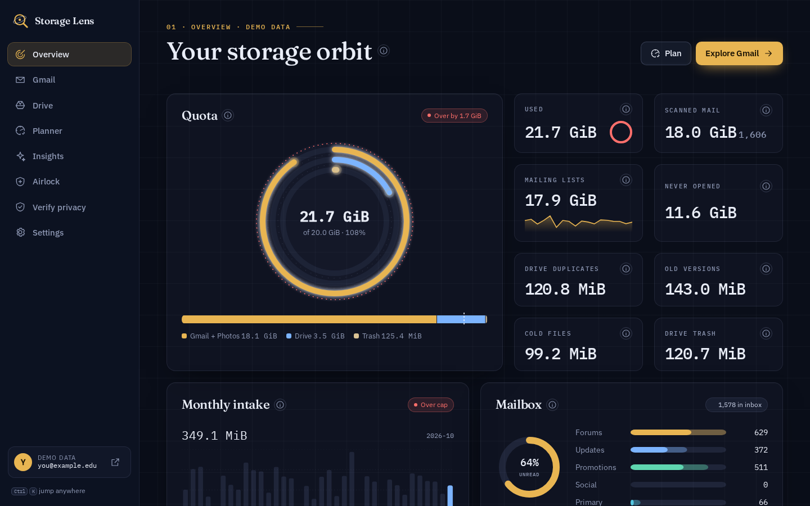
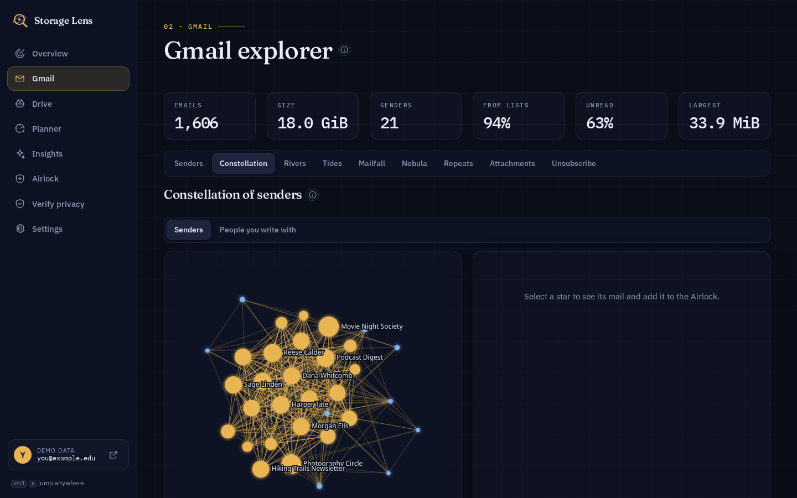
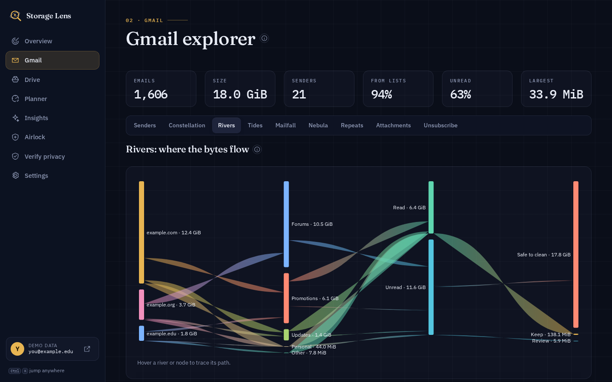
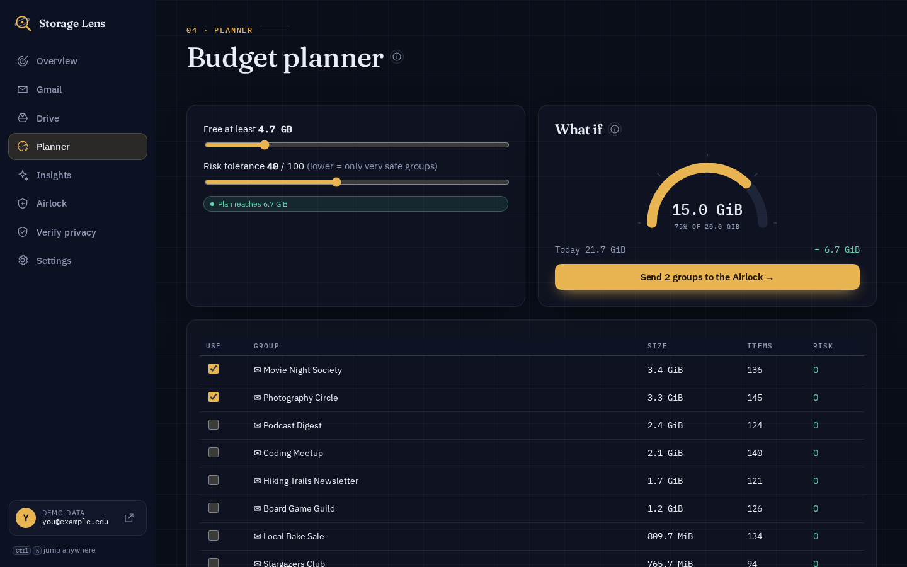
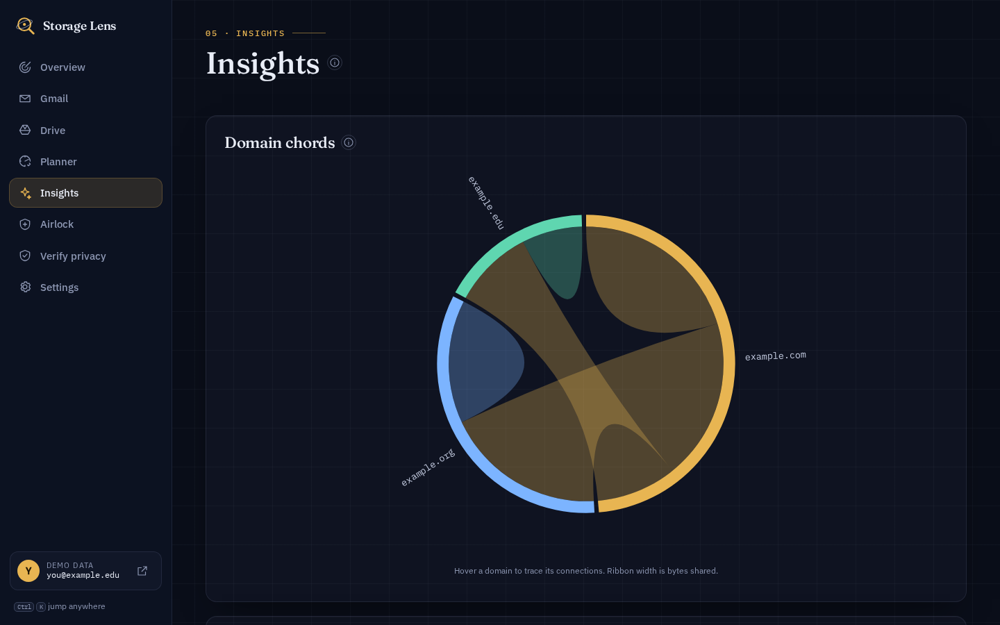
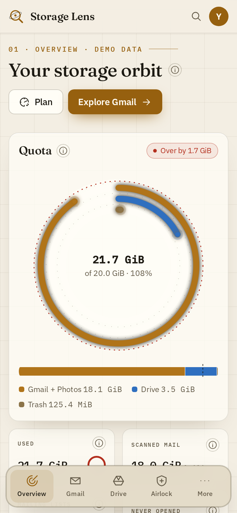

# Gmail Storage Lens

[](https://github.com/Shuvam-Banerji-Seal/gmail-drive-storage-lens/actions/workflows/ci.yml)
[](https://github.com/Shuvam-Banerji-Seal/gmail-drive-storage-lens/actions/workflows/pages.yml)
[](LICENSE)
[](https://shuvam-banerji-seal.github.io/gmail-drive-storage-lens/)

**Gmail Storage Lens** is an open-source, browser-only analyzer and cleaner for Gmail and Google Drive storage. It shows what is using your Google storage, lets you explore it visually, and helps you clean it up with a preview and explicit confirmation before anything changes.

It runs entirely in your browser. There is no backend, no account on our side, and no analytics. You create your own Google Cloud OAuth client and paste its Client ID into the app, so the project never holds your tokens and never collects your data.

> **Status: early development (0.1.0).** The repository currently contains the project scaffold, analytics core, and the API layer. Items marked **(planned)** below are on the [roadmap](docs/roadmap.md) and are not yet available.

**Live app:** https://shuvam-banerji-seal.github.io/gmail-drive-storage-lens/

## Features

- **Storage overview.** A quota view that splits usage across Drive and Gmail, with Google Photos shown as an estimate (the remainder). (planned)
- **Gmail explorer.** Sizes grouped by sender, mailing list, and subject, with a treemap and timeline. Only headers, sizes, and labels are read. (planned)
- **Sender relationship graph.** Senders as nodes, linked by shared threads or mailing lists, coloured by community. (planned)
- **Drive explorer.** Folder treemap by storage used, duplicate detection by checksum, and lists of large, old, and public files. (planned)
- **Safe cleanup.** Select items, get a dry run with exact totals and exclusions (starred, sent, drafts, and your contacts are protected by default), export a CSV plan, then move to Trash. Permanent delete requires a separate, typed confirmation. (planned)
- **Bring your own client.** A guided setup wizard for your own Google OAuth Web client, with a connection test and plain-language fixes for common errors. (planned)
- **Demo mode.** Explore every view with synthetic data, without signing in. (planned)

## Quick start (development)

Requirements: Node.js 24 and npm.

```bash
git clone https://github.com/Shuvam-Banerji-Seal/gmail-drive-storage-lens.git
cd gmail-drive-storage-lens
npm ci
npm run dev
```

Open http://localhost:5173. For sign-in to work during development, add `http://localhost:5173` as an authorized JavaScript origin on your OAuth client (see the setup guide below).

Other useful scripts:

| Command | What it does |
|---|---|
| `npm run lint` | Lints the source with oxlint |
| `npm run typecheck` | Runs the TypeScript compiler in build mode |
| `npm run test` / `npm run test:cov` | Unit tests (Vitest), with coverage for the analytics, API, and utility modules |
| `npm run build` | Type-checks and produces a production build in `dist/` |
| `npm run check:csp` | Verifies that the network hosts used in source are on the allowlist |
| `npm run check:licenses` | Verifies that dependency licenses are compatible with AGPL-3.0 |
| `npm run e2e` | End-to-end tests (Playwright) |

## Use it

1. **Create your own OAuth client.** Google requires an OAuth client for any app that reads Gmail or Drive. Follow the step-by-step guide in [docs/oauth-setup.md](docs/oauth-setup.md) (about five minutes). A plain-language version is in the [wiki](docs/wiki/Getting-Started.md).
2. **Open the app** at the live URL above, or run it locally.
3. **Paste your Client ID** (it ends in `.apps.googleusercontent.com`). The Client ID is public and is not a secret. If anything asks for a client secret, stop: this app never needs one.
4. **Sign in** with the Google account you added as a test user. The app starts with read-only access.
5. **Explore, then clean.** Broader permissions are requested only when you choose to delete something, and deletion defaults to Trash.

## Privacy model

- **No server.** The site is static files on GitHub Pages. The repository contains no server code, no API keys, and no database configuration.
- **Your credentials, your project.** Sign-in uses Google Identity Services in your browser with an OAuth client that you own. The project maintainers never see your tokens or your consent.
- **Metadata only.** The app reads headers (From, To, Subject, Date, List-Id, List-Unsubscribe), sizes, labels, and Drive file metadata. It does not download message bodies or file contents.
- **Local storage.** Cached metadata lives in your browser (IndexedDB) and is cleared on sign-out. Nothing is uploaded anywhere.
- **Nothing leaves the browser except to Google.** The only hosts the app may contact are Google's APIs and sign-in endpoints.
- **No analytics, no third-party scripts, no remote fonts.**

The privacy promise is enforced by the browser, not just by policy: the production build ships a strict Content-Security-Policy (`connect-src` limited to Google's hosts; `script-src` limited to the app and Google's sign-in library). CI fails if the policy is loosened or a new network host appears in the source.

### How to verify it yourself

1. Open the live app, open your browser's developer tools (F12), and go to the **Network** tab.
2. Sign in and run a scan. Every request should go to `googleapis.com`, `gmail.googleapis.com`, `accounts.google.com`, or `oauth2.googleapis.com`.
3. In the page source, check the `Content-Security-Policy` meta tag, which lists the allowed hosts.
4. Verify that a deployed build came from this repository's source. See [docs/verification.md](docs/verification.md) for `gh attestation verify` and the network allowlist check.

## Architecture

```
Browser (static site, GitHub Pages)
 ├─ Google Identity Services  ->  access token (held in memory)
 ├─ API layer (fetch)         ->  Gmail REST + Drive REST, rate-limited queue with backoff
 ├─ Analytics (pure functions) ->  clustering, scores, graphs, planning (no I/O)
 ├─ Web Workers                ->  scanning and heavy computation, off the UI thread
 ├─ IndexedDB (Dexie)          ->  cached metadata only, cleared on sign-out
 └─ UI (React, charts)         ->  overview, explorers, cleanup
```

The full data pipeline, rate-limit arithmetic, and module map are in [docs/architecture.md](docs/architecture.md). The design language is described in [docs/DESIGN.md](docs/DESIGN.md) and the module APIs in [docs/MODULES.md](docs/MODULES.md).

## Permissions (scopes)

The app asks for the least access needed for each step. See [docs/scopes.md](docs/scopes.md) for the full table.

| Stage | Scope | Used for |
|---|---|---|
| Explore (read-only) | `gmail.readonly`, `drive.metadata.readonly` | Sizes, senders, subjects, labels, folder and file metadata |
| Trash in Gmail | `gmail.modify` | Moving selected messages to Trash (planned) |
| Permanent Gmail delete | `https://mail.google.com/` | Only after a separate, typed confirmation (planned) |
| Clean Drive | `drive` | Trashing or deleting Drive files (planned) |

Note that `gmail.readonly` is broader than what the app uses: it technically permits reading message content. The app requests headers only and never downloads bodies.

## FAQ

**Is this an official Google app?**
No. It is an independent open-source project, not affiliated with or endorsed by Google.

**Why do I need my own Google Cloud project?**
Gmail and broad Drive access are "restricted" scopes. Google requires a verification and security assessment before an app can offer them to the public. Having each user create a client for their own account avoids that, and keeps your credentials out of anyone else's hands.

**Does it delete anything without asking?**
Cleanup defaults to moving items to Trash, which Google keeps for 30 days. Permanent deletion needs a separate confirmation.

**Will the numbers match Google's storage page exactly?**
No. Gmail sizes are estimates from message metadata, and Google's page can lag by minutes to hours after a change. Treat "bytes freed" as an estimate until Google's page updates.

**Can it free space by removing attachments but keeping the message?**
No. The Gmail API cannot remove one attachment while keeping its message. The app can help you download attachments first and then delete the messages (planned).

**Can it analyse Google Photos?**
No. Google removed the read and search scopes of the Photos Library API in 2025. Photos usage can only be estimated as the part of your quota that Drive and Gmail do not account for.

**Does the 7-day expiry in Testing mode affect me?**
The app uses the browser token flow and does not use refresh tokens, so the 7-day expiry of refresh tokens does not apply. You simply sign in again when a session ends.

## Honest limitations

- Gmail storage is estimated from `sizeEstimate`, so totals can differ slightly from Google's own numbers.
- Google Photos cannot be measured directly; it is shown only as an estimate.
- There is no background or scheduled cleanup. Filters (planned) are the closest substitute.
- Quota limits are real: a large mailbox can take several minutes to scan, and the app pauses and retries when Google rate-limits it.
- Your Google account may be managed by a Workspace administrator who blocks third-party apps or creating Cloud projects. The app explains the common errors, but cannot override those policies.
- Google may change the Cloud Console and consent screen wording. The setup guide is text-first so it is easy to keep current.
- A fork hosted by someone else is that person's code. Trust the official repository's Pages URL, or build and host the app yourself.

## Contributing

Contributions are welcome: bug reports, documentation, accessibility fixes, and code. Please read [CONTRIBUTING.md](CONTRIBUTING.md) and the [Code of Conduct](CODE_OF_CONDUCT.md) first. Questions and ideas belong in [Discussions](https://github.com/Shuvam-Banerji-Seal/gmail-drive-storage-lens/discussions). Security issues must be reported privately; see [SECURITY.md](SECURITY.md).

Project rules that every change must respect: no network hosts beyond the allowlist, metadata only (never message bodies or file contents), and no analytics.

## Screenshots

All screenshots use the built-in synthetic demo data (nothing real).

| | |
|---|---|
|  |  |
|  |  |
|  |  |
|  |  |
|  |  |
|  |  |

## Licence

Gmail Storage Lens is free software licensed under the **GNU Affero General Public License v3.0 or later** (`AGPL-3.0-or-later`). You may use, study, modify, and redistribute it. If you modify it and make it available to others over a network, you must offer those users the source of your modified version. See the [LICENSE](LICENSE) file for the full text.

## Trademark notice

Gmail and Google Drive are trademarks of Google LLC. Google Cloud, Google Identity, and other Google product names are used here only to describe compatibility. This project is not affiliated with, sponsored by, or endorsed by Google LLC.
