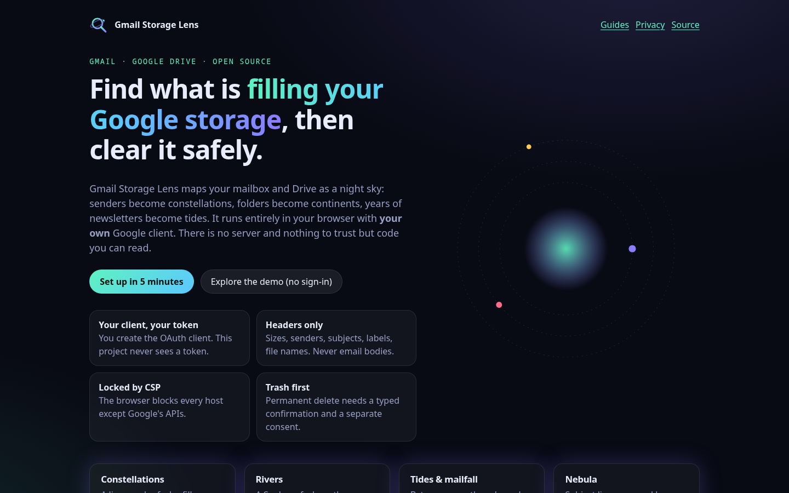
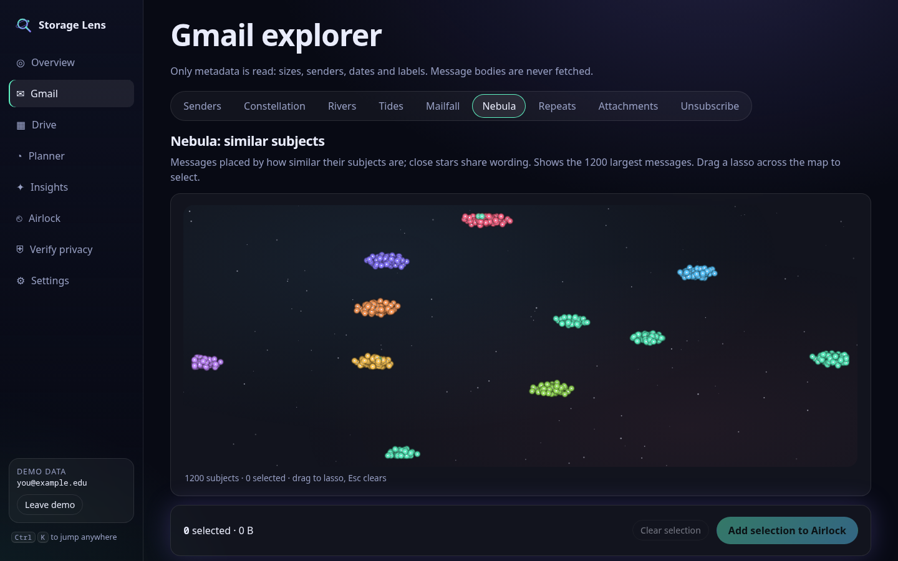
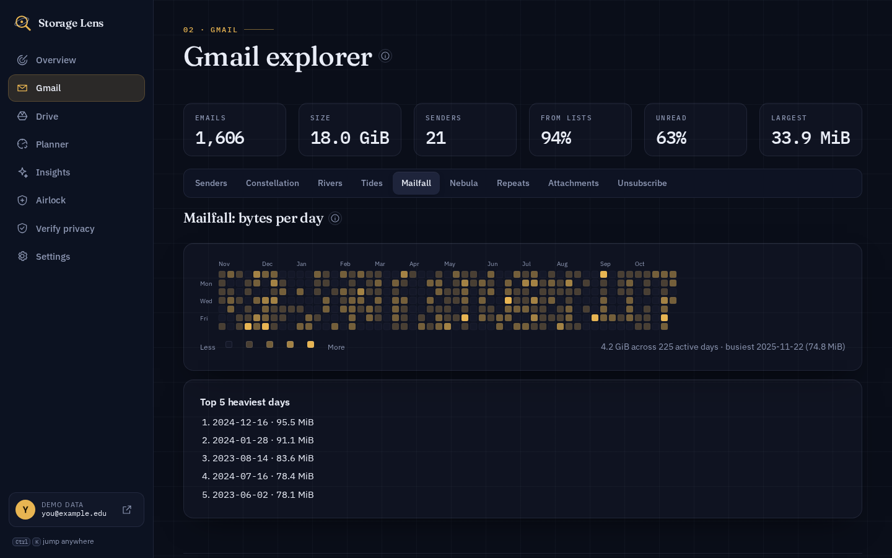
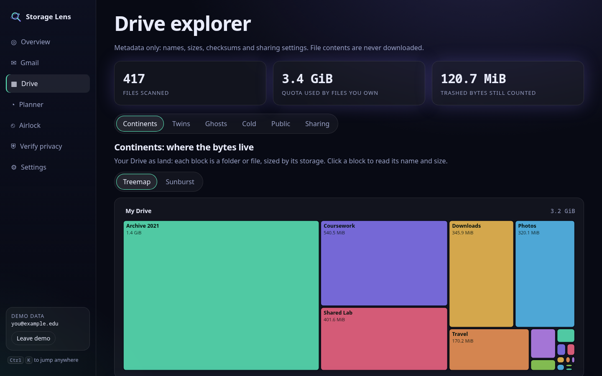
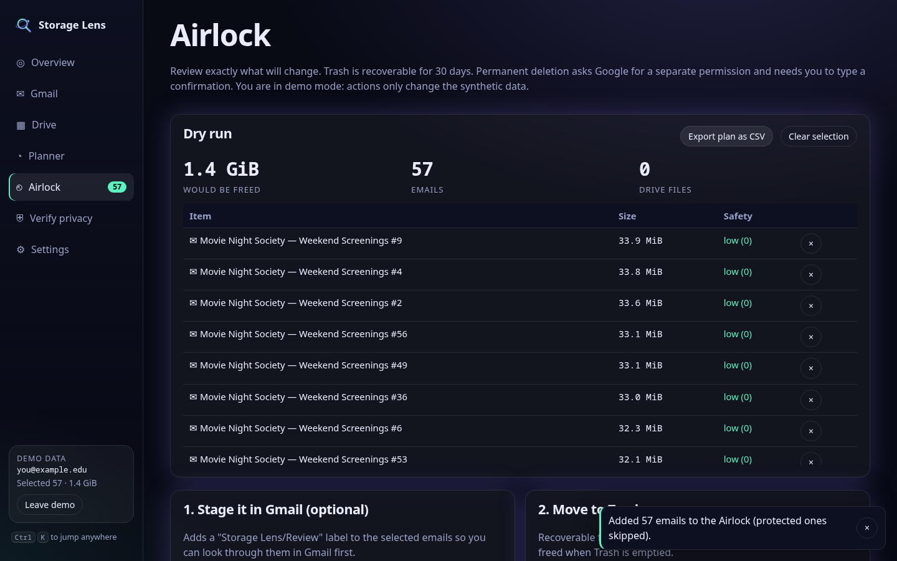
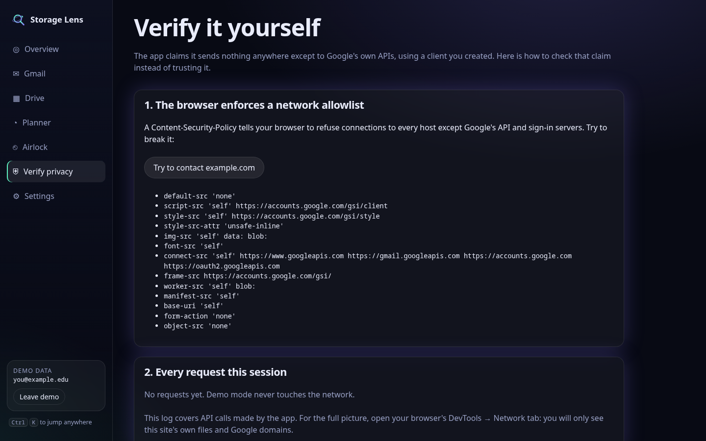

# Gmail Storage Lens

[](https://github.com/Shuvam-Banerji-Seal/gmail-drive-storage-lens/actions/workflows/ci.yml)
[](https://github.com/Shuvam-Banerji-Seal/gmail-drive-storage-lens/actions/workflows/pages.yml)
[](LICENSE)
[](https://shuvam-banerji-seal.github.io/gmail-drive-storage-lens/)

**Gmail Storage Lens** is an open-source, browser-only analyzer and cleaner for Gmail and Google Drive storage. It shows what is using your Google storage, lets you explore it visually, and helps you clean it up with a preview and explicit confirmation before anything changes.

It runs entirely in your browser. There is no backend, no account on our side, and no analytics. You create your own Google Cloud OAuth client and paste its Client ID into the app, so the project never holds your tokens and never collects your data.

**Live app:** https://shuvam-banerji-seal.github.io/gmail-drive-storage-lens/ (the built-in demo runs with synthetic data and needs no sign-in)

## Features

- **Demo mode.** Every view runs on synthetic data, so you can explore before you connect an account.
- **Overview.** Quota split across Drive and Gmail, a monthly intake chart with spike detection, a "full in N months" forecast, and explainable recommendations.
- **Gmail explorer.** Senders, a sender constellation graph, Sankey flows, a time replay, a calendar heatmap, a subject map with lasso selection, repeated attachments, unsubscribe candidates, and an optional attachment structure scan.
- **Drive explorer.** Folder treemap and sunburst, duplicates by checksum with keep rules, old revisions that still count toward quota, cold files, a public-link audit, and a sharing graph.
- **Insights and planner.** A domain chord diagram, people who appear in both Gmail and Drive, and a budget planner with a what-if gauge.
- **Airlock (cleanup).** Rule-based selection with the equivalent Gmail search, dry run, CSV plan, optional `.mbox` archive, Move to Trash with Undo, typed confirmation for permanent deletes, emptying Drive Trash and Gmail Trash or Spam, a Gmail filter generator, and receipts.
- **Verify privacy.** A live map of every network request, the enforced Content-Security-Policy, build provenance, and what is stored on this device.
- **Setup wizard.** A six-step guide to your own OAuth client, with a connection test and plain-language fixes. A pre-filled setup link is available.
- **Incremental sync and encrypted saves.** "Sync changes" uses Gmail history and Drive changes. You can save a scan encrypted with a passphrase.
- **Settings.** Five themes (Auto, Atlas, Graphite, Paper, High contrast), a storage cap, account switching, a guided tour, and Wipe this device.
- **Command palette and responsive layout.** Ctrl/Cmd+K opens the palette. Desktop uses a sidebar, tablets an icon rail, and phones an app bar with a bottom tab bar.

## Quick start (development)

Requirements: Node.js 24 and npm.

```bash
git clone https://github.com/Shuvam-Banerji-Seal/gmail-drive-storage-lens.git
cd gmail-drive-storage-lens
npm ci
npm run dev
```

Open http://localhost:5173. For sign-in to work during development, add `http://localhost:5173` as an authorized JavaScript origin on your OAuth client (see the setup guide below).

Other useful scripts:

| Command | What it does |
|---|---|
| `npm run lint` | Lints the source with oxlint |
| `npm run typecheck` | Runs the TypeScript compiler in build mode |
| `npm run test` / `npm run test:cov` | Unit tests (Vitest), with coverage for the analytics, API, and utility modules |
| `npm run build` | Type-checks and produces a production build in `dist/` |
| `npm run check:csp` | Verifies that the network hosts used in source are on the allowlist |
| `npm run check:licenses` | Verifies that dependency licenses are compatible with AGPL-3.0 |
| `npm run e2e` | End-to-end tests (Playwright, with a mocked Google) |
| `npm run live-check` | Read-only check against a real account (`GMAIL_TOKEN=... DRIVE_TOKEN=...`); refuses non-GET requests |

## Use it

1. **Create your own OAuth client.** Google requires an OAuth client for any app that reads Gmail or Drive. Follow the step-by-step guide in [docs/oauth-setup.md](docs/oauth-setup.md) (about five minutes). A plain-language version is in the [wiki](docs/wiki/Getting-Started.md).
2. **Open the app** at the live URL above, or run it locally. To look around first, choose **Explore the demo**.
3. **Paste your Client ID** into the setup wizard (it ends in `.apps.googleusercontent.com`). The Client ID is public and is not a secret. If anything asks for a client secret, stop: this app never needs one.
4. **Sign in** with the Google account you added as a test user. The app starts with read-only access.
5. **Explore, then clean.** Broader permissions are requested only when you choose to delete something, and deletion defaults to Trash.

## Privacy model

- **No server.** The site is static files on GitHub Pages. The repository contains no server code, no API keys, and no database configuration.
- **Your credentials, your project.** Sign-in uses Google Identity Services in your browser with an OAuth client that you own. The project maintainers never see your tokens or your consent.
- **Metadata only by default.** The app reads headers (From, To, Subject, Date, List-Id, List-Unsubscribe), sizes, labels, and Drive file metadata. Message content is read in two cases you choose: the optional attachment structure scan (names, types, and sizes, never bodies), and the `.mbox` archive download, which saves the selected emails straight to your device. See [docs/privacy.md](docs/privacy.md#when-content-is-read).
- **Local storage you control.** The session lives in memory and is cleared on sign-out. A scan is saved in your browser only when you choose to save it, and then it is encrypted with your passphrase (PBKDF2 and AES-GCM). **Wipe this device** removes everything the app stored. Nothing is uploaded anywhere.
- **Nothing leaves the browser except to Google.** The only hosts the app may contact are Google's APIs and sign-in endpoints.
- **No analytics, no third-party scripts, no remote fonts.** Fonts are bundled with the app.

The privacy promise is enforced by the browser, not just by policy: the production build ships a strict Content-Security-Policy (`connect-src` limited to Google's hosts; `script-src` limited to the app and Google's sign-in library). CI fails if the policy is loosened or a new network host appears in the source.

### How to verify it yourself

1. Open the live app, open your browser's developer tools (F12), and go to the **Network** tab.
2. Sign in and run a scan. Every request should go to `googleapis.com`, `gmail.googleapis.com`, `accounts.google.com`, or `oauth2.googleapis.com`.
3. Open the **Verify privacy** page in the app to see the live request map, the enforced policy, and the build commit.
4. Verify that a deployed build came from this repository's source. See [docs/verification.md](docs/verification.md) for `gh attestation verify` and the network allowlist check.

## Architecture

```
Browser (static site, GitHub Pages)
 ├─ Google Identity Services  ->  access token (held in memory)
 ├─ API layer (fetch)         ->  Gmail REST + Drive REST, rate-limited queue with backoff
 ├─ Analytics (pure functions) ->  clustering, scores, graphs, planning (no I/O)
 ├─ Web Workers                ->  scanning, clustering, and subject embedding (UMAP), off the UI thread
 ├─ IndexedDB (Dexie)          ->  optional scan saves, encrypted with a passphrase; removed by Wipe
 └─ UI (React, charts)         ->  overview, explorers, cleanup
```

The full data pipeline, rate-limit arithmetic, and module map are in [docs/architecture.md](docs/architecture.md). The design language is described in [docs/DESIGN.md](docs/DESIGN.md) and the module APIs in [docs/MODULES.md](docs/MODULES.md).

## Permissions (scopes)

The app asks for the least access needed for each step. Sign-in requests read-only access, and each cleaning action requests its own scope only when you trigger it. See [docs/scopes.md](docs/scopes.md) for the full table.

| Stage | Scope | Used for |
|---|---|---|
| Sign-in and explore | `gmail.readonly`, `drive.metadata.readonly` | Sizes, senders, subjects, labels, folder and file metadata, incremental sync |
| Move to Trash, review label | `gmail.modify` | Moving selected messages to Trash, and adding the "Storage Lens/Review" label |
| Permanent Gmail delete, empty Gmail Trash or Spam | `https://mail.google.com/` | Only after a separate, typed confirmation |
| Gmail filters | `gmail.settings.basic` | Creating a filter you have reviewed |
| Drive cleanup | `drive` | Trashing, deleting, pruning old revisions, and emptying Drive Trash |

The app does not request `gmail.labels`: the review label works under `gmail.modify`.

Note that `gmail.readonly` is broader than what the app uses: it technically permits reading message content. The app requests headers only by default, and reads content only in the two opt-in cases described in [docs/privacy.md](docs/privacy.md#when-content-is-read).

## FAQ

**Is this an official Google app?**
No. It is an independent open-source project, not affiliated with or endorsed by Google.

**Why do I need my own Google Cloud project?**
Gmail and broad Drive access are "restricted" scopes. Google requires a verification and security assessment before an app can offer them to the public. Having each user create a client for their own account avoids that, and keeps your credentials out of anyone else's hands.

**Does it delete anything without asking?**
Cleanup defaults to moving items to Trash, which Google keeps for 30 days. Permanent deletion, and emptying Trash or Spam, need a separate typed confirmation.

**Will the numbers match Google's storage page exactly?**
No. Gmail sizes are estimates from message metadata, and Google's page can lag by minutes to hours after a change. Treat "bytes freed" as an estimate until Google's page updates.

**Can it free space by removing attachments but keeping the message?**
No. The Gmail API cannot remove one attachment while keeping its message. The Airlock can download a `.mbox` archive of the selected emails to your device, so you can keep a copy before you move the messages to Trash.

**Can it analyse Google Photos?**
No. Google removed the read and search scopes of the Photos Library API in 2025. Photos usage can only be estimated as the part of your quota that Drive and Gmail do not account for.

**Does the 7-day expiry in Testing mode affect me?**
The app uses the browser token flow and does not use refresh tokens, so the 7-day expiry of refresh tokens does not apply. You simply sign in again when a session ends.

## Honest limitations

- Gmail storage is estimated from `sizeEstimate`, so totals can differ slightly from Google's own numbers.
- Google Photos cannot be measured directly; it is shown only as an estimate.
- There is no background or scheduled cleanup, because the app runs only while its page is open. The Gmail filter generator is the closest substitute.
- Quota limits are real: a large mailbox can take several minutes to scan, and the app pauses and retries when Google rate-limits it.
- Your Google account may be managed by a Workspace administrator who blocks third-party apps or creating Cloud projects. The app explains the common errors, but cannot override those policies.
- Google may change the Cloud Console and consent screen wording. The setup guide is text-first so it is easy to keep current.
- A fork hosted by someone else is that person's code. Trust the official repository's Pages URL, or build and host the app yourself.

## Contributing

Contributions are welcome: bug reports, documentation, accessibility fixes, and code. Please read [CONTRIBUTING.md](CONTRIBUTING.md) and the [Code of Conduct](CODE_OF_CONDUCT.md) first. Questions and ideas belong in [Discussions](https://github.com/Shuvam-Banerji-Seal/gmail-drive-storage-lens/discussions). Security issues must be reported privately; see [SECURITY.md](SECURITY.md).

Project rules that every change must respect: no network hosts beyond the allowlist, metadata only (message content only in the documented opt-in cases), and no analytics.

## Screenshots

All screenshots use the built-in synthetic demo data (nothing real).

| | |
|---|---|
|  |  |
|  |  |
|  |  |
|  |  |
|  |  |
|  |  |

## Licence

Gmail Storage Lens is free software licensed under the **GNU Affero General Public License v3.0 or later** (`AGPL-3.0-or-later`). You may use, study, modify, and redistribute it. If you modify it and make it available to others over a network, you must offer those users the source of your modified version. See the [LICENSE](LICENSE) file for the full text.

## Trademark notice

Gmail and Google Drive are trademarks of Google LLC. Google Cloud, Google Identity, and other Google product names are used here only to describe compatibility. This project is not affiliated with, sponsored by, or endorsed by Google LLC.
