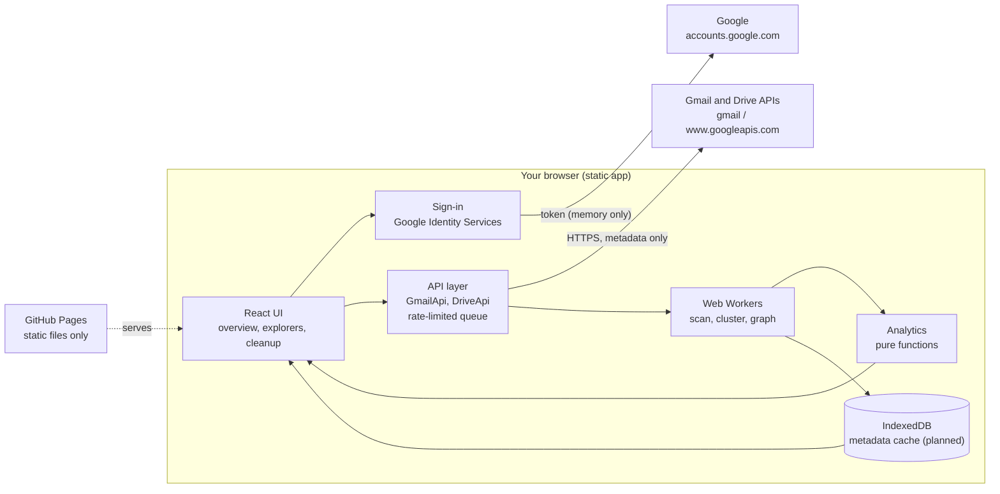

# Architecture

Gmail Storage Lens is a static, browser-only application. It has no server, no database, and no background jobs. This document explains how the pieces fit together, how data moves from Google to your screen, and why the scanning code is paced the way it is.

## System overview

The only network destinations are Google's hosts. The static host serves the application files and receives no data from you.

## Layers

| Layer | Responsibility | Key rule |
|---|---|---|
| Presentation (`src/features`, `src/components`, `src/charts`) | Views, charts, tables, and cleanup flows | Every chart has a text or table alternative |
| State (`src/state`) | Application state (Zustand) | Holds no tokens outside memory |
| Analytics (`src/analytics`) | Clustering, scoring, graphs, planning, and CSV export | Pure functions, no I/O, fully unit tested |
| API (`src/api`) | Requests to Gmail and Drive, batching, rate limits, retries | Metadata only; destructive calls require confirmation arguments |
| Workers (`src/workers`) | Long-running scans and heavy computation | The UI thread is never blocked |
| Config and demo (`src/config`, `src/demo`) | Settings and synthetic demo data | Demo data is always synthetic |

The module-level APIs are in [MODULES.md](MODULES.md). The visual language is in [DESIGN.md](DESIGN.md).

## Data pipeline

A scan moves through five stages:

1. **Overview first.** Label summaries (`labels.get`) and Drive quota (`about.get`) give immediate totals, so the dashboard can paint before the deep scan starts.
2. **Size-first tiers.** Gmail is queried in tiers of decreasing size, for example `larger:25M`, then `10M`, `5M`, `2M`, and `1M`. The largest messages arrive first, so you see the biggest wins within seconds and can stop early.
3. **Metadata fetch.** Each message is requested with `format=metadata` and only the headers listed in [privacy.md](privacy.md). Requests run several at a time through one queue.
4. **Deduplicate and cache.** Results are de-duplicated by message identifier and skipped if already known. Metadata is cached in IndexedDB (planned) so an interrupted scan can resume.
5. **Analyse off the UI thread.** Workers compute clusters, scores, graphs, and series. The UI receives compact results.

Drive follows a similar path: a single paged `files.list` request with a trimmed set of fields and a page size of 1000.

## Rate-limit arithmetic

Google limits each user's Gmail usage by quota units per second. The app is designed around the documented figures at the time of writing, which should be checked against Google's current quota documentation.

| Call | Quota units (per call) |
|---|---|
| `users.messages.get` | 5 |
| `users.messages.list` | 5 |
| `users.labels.get` | 1 |
| `users.history.list` | 2 |
| `users.messages.batchModify` | 50 |
| `users.messages.batchDelete` | 50 |

The per-user limit is 250 quota units per second. At that limit, the most `messages.get` calls per second is:

> 250 units/s ÷ 5 units per call = **50 messages per second**

For a mailbox of 40,000 messages, a full metadata scan needs:

> 40,000 messages × 5 units = 200,000 units
> 200,000 units ÷ 250 units/s = **800 seconds, about 13 minutes**

This is the theoretical best case. Real scans are slower because of network latency, retries, and backoff. That is why the scan is tiered: the largest messages, which matter most for storage, are fetched first. Users rarely need every message to find the space they can free.

Batch endpoints are used where they help. A batch request can carry up to 100 calls, which reduces round trips but does not reduce the quota units each call costs.

## Error handling

- **429 and 5xx responses:** exponential backoff with jitter, then a retry.
- **Token expiry:** the app asks you to sign in again rather than storing refresh tokens.
- **Scope insufficient:** the app requests the additional scope only at the step that needs it.
- **Quota exhausted for the day:** the app stops, keeps what it has, and explains the state.

## Module map

| Area | Path | Contents |
|---|---|---|
| Types | `src/types.ts` | Shared types for messages, files, and results |
| Formatting | `src/util/format.ts` | Human-readable sizes and dates |
| Parsing | `src/analytics/parse.ts` | Header and address parsing |
| Clustering | `src/analytics/cluster.ts` | Sender and list clusters, subject similarity (TF-IDF) |
| Scoring | `src/analytics/scores.ts` | Safety score and noise score, protected-item rules |
| Planning | `src/analytics/planner.ts` | Budget planner and what-if calculation |
| Drive analytics | `src/analytics/drive.ts` | Duplicates, revision bloat, cold files, trees, share graph |
| Series | `src/analytics/series.ts` | Monthly series, anomalies, forecast, Sankey data |
| Graphs | `src/analytics/graphs.ts` | Sender graph, communities, PageRank, attachment groups |
| Embeddings | `src/analytics/embed.ts` | Hashed bag-of-words vectors and 2D layout |
| Export and filters | `src/analytics/csv.ts`, `filters.ts`, `unsub.ts` | CSV export, Gmail filter bodies, unsubscribe radar |
| Gmail API | `src/api/` | `GmailApi`, built on a shared HTTP client |
| Drive API | `src/api/` | `DriveApi`, built on the same HTTP client |
| Security headers | `vite.config.ts` | Content-Security-Policy injected into production builds |

## Build and deployment

- `npm run build` runs the TypeScript build check and then Vite. Production builds inject the Content-Security-Policy.
- The `BASE_PATH` environment variable sets the public path. The GitHub Pages workflow sets it to `/gmail-drive-storage-lens/`.
- The Pages workflow builds the site, attests build provenance for `dist/index.html` and `dist/assets/*`, and then deploys. See [verification.md](verification.md).

## Design decisions

- **No backend.** Removes the need to hold or protect user data.
- **Bring your own OAuth client.** Avoids Google's verification process for restricted scopes and keeps credentials out of the project.
- **Metadata only.** Reduces both the privacy surface and the quota cost.
- **Trash by default.** Makes mistakes recoverable.
- **Pure analytics.** Keeps the most important logic easy to test without a browser.
